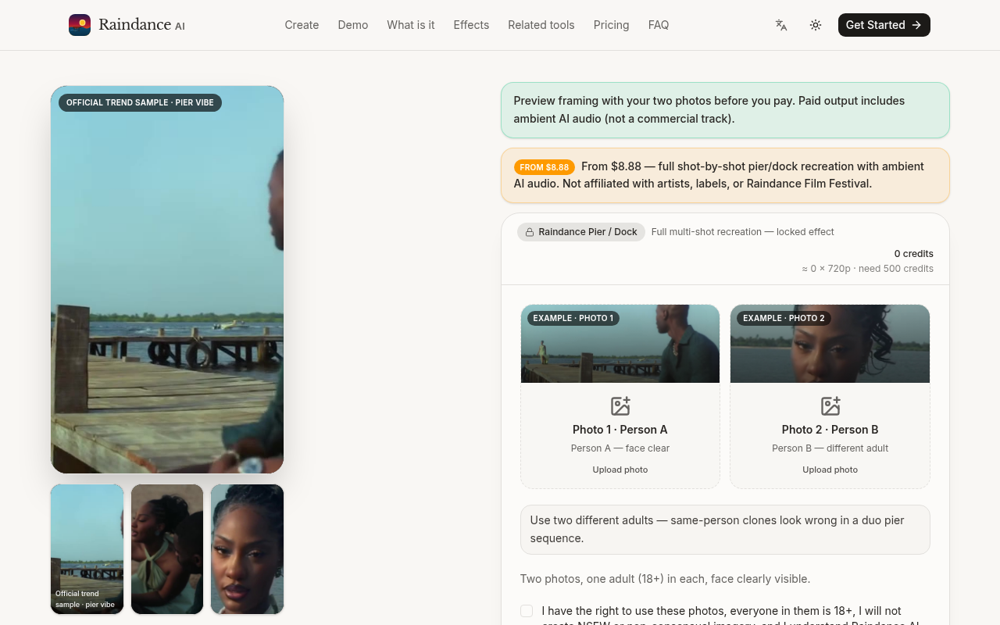

# Raindance AI

  

  <strong>两张照片 → 码头/栈桥多镜头氛围双人短片</strong> 
  付费成片约 15s · 竖屏友好 · 游客可付 
  起价 <b>$8.88</b> · 无订阅、无需注册

  
  

---

## 截图

  
  

---

## 怎么用

1. 打开 [raindanceai.click](https://raindanceai.click)
2. 上传 Person A / Person B 两张不同成年人正脸照
3. 预览构图 → 选画幅 / 分辨率 → Create
4. Stripe：Single **$8.88** / 3-pack **$16.99** / 10-pack **$24.90**（约 **15 秒**）

---

## 产品要点

- **多镜头分镜**：码头入场 → 栈桥中段 → 特写 → 剪影
- 付费成片约 **15 秒**；含 AI 环境音（示例多为静音预览）
- 需两位不同的人；同人分身会很违和
- 独立粉丝工具；与艺人、厂牌、同名电影节无关

---

## 定价

| 套餐 | 价格 | 积分 |
|---|---|---|
| Single | $8.88 | 500 ≈ 1×720p |
| 3-pack | $16.99 | 1500 ≈ 3×720p |
| 10-pack | $24.90 | 5000 ≈ 10×720p |

一次性积分包，无订阅。英文简介：*Two photos → multi-shot pier/boardwalk duo sequence → MP4 with AI ambient audio.*

---

## Links

- 官网：https://raindanceai.click
- GitHub Pages：https://xianyu110.github.io/raindance-ai/
- 仓库：https://github.com/xianyu110/raindance-ai

---

## License

Demo media for product showcase. Site © Maynor / xianyu110. Please only upload photos you own or have permission to use. Fan tool — unaffiliated with original artists, labels, or rights holders.
